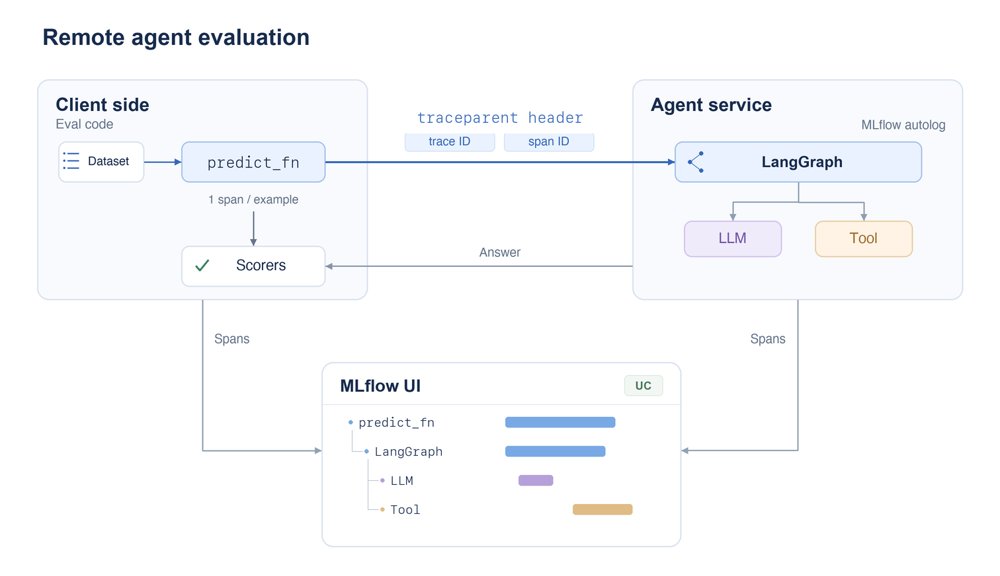
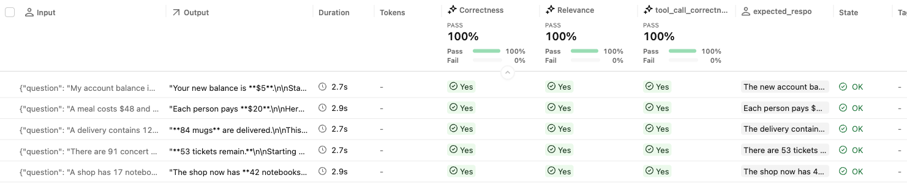
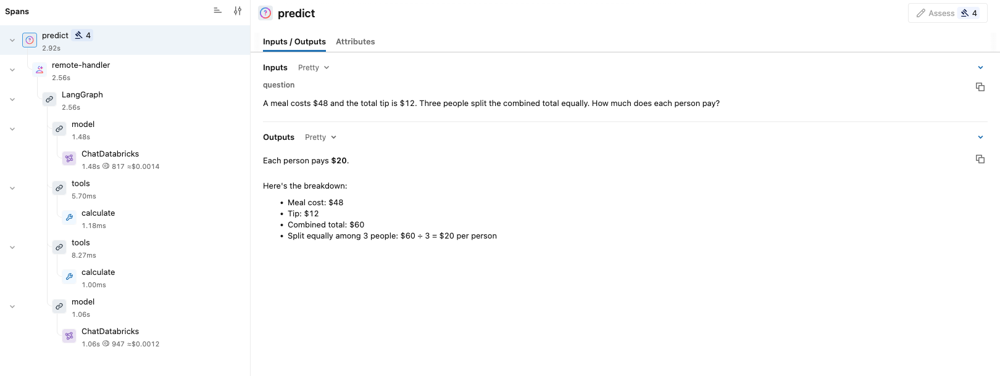

# Evaluate remote agents with MLflow

This repo shows how to run MLflow evaluation against an agent behind a remote
endpoint. It uses [distributed tracing](https://mlflow.org/docs/latest/genai/tracing/app-instrumentation/distributed-tracing/)
to give evaluation one trace containing both the client prediction and the
remote agent's execution.

The example includes five evaluation tasks, three LLM judges, and a tool-calling
LangGraph agent. Traces are stored in Unity Catalog.

## How evaluation with a remote agent works

MLflow evaluates each dataset example by calling `predict_fn`. In this example,
each prediction creates a trace for that task. Some scorers judge the answer;
trace-aware scorers such as `ToolCallCorrectness` also need the agent's tool spans
to evaluate how it solved the task.

A remote agent runs in another process, so its spans do not automatically become
part of the client's evaluation trace. An HTTP call can return the correct answer
while leaving the agent's execution in a separate trace. Distributed tracing
connects the two:



1. The client creates a root span for each prediction. `predict_fn` passes its
   trace ID and span ID to the remote endpoint in a W3C `traceparent` header.
2. The agent service restores that context before invoking the agent. MLflow
   autologging creates agent, LLM, and tool spans under the same trace ID, as
   descendants of the client's prediction span.
3. Both processes export to the same UC-backed experiment. MLflow retrieves the
   unified trace for each task and makes it available to evaluation's trace-aware
   scorers.

## Screenshots

These show the real workspace results in the open-source MLflow UI connected
to the E2 backend. Workspace and user details are omitted.

The evaluation run shows the five examples and LLM judge assessments.



A trace connects the local prediction with the remote LangGraph agent, including
its LLM calls and calculator tool.



## Repository layout

```text
app.py             FastAPI + LangGraph agent + Databricks LLM + calculator tool
eval.py            Dataset, HTTP predict function, and three LLM judges
requirements.txt   Shared pinned Python dependencies
app.yaml           App startup and resource-backed environment variables
databricks.yml     App deployment and resource permissions
.gitignore         Excludes credentials and local artifacts
README.md          This guide
docs/images/       Architecture diagram and UI screenshots
```

## Local setup

Requires Python 3.11+, `uv`, and a recent Databricks CLI with Apps/bundle support.
Use an OAuth profile for your E2 workspace. If you need a new login, set
`DATABRICKS_HOST` to your workspace URL and run
`databricks auth login --host "$DATABRICKS_HOST"`.

```bash
uv venv --python 3.11
uv pip install --python .venv/bin/python --exclude-newer P7D -r requirements.txt

export DATABRICKS_CONFIG_PROFILE="<your-oauth-profile>"
export MLFLOW_TRACKING_URI=databricks
```

MLflow and the Databricks SDK read their usual environment variables directly.
The App uses its own service principal through Databricks unified authentication.
No workspace URLs, tokens, or client secrets belong in tracked configuration.

## Create a shared UC tracing experiment

Choose an existing catalog/schema you can manage and a SQL warehouse you can use.
The evaluator and App must use the same experiment and UC trace destination.

```bash
export DATABRICKS_APP_NAME="<your-app-name>"
export MLFLOW_TRACING_SQL_WAREHOUSE_ID="<your-warehouse-id>"
export TRACE_CATALOG="<your-catalog>"
export TRACE_SCHEMA="<your-schema>"
export TRACE_TABLE_PREFIX=calculator
export LLM_ENDPOINT=databricks-claude-haiku-4-5
```

If the schema does not exist, create it first:

```bash
databricks schemas create "$TRACE_SCHEMA" "$TRACE_CATALOG"
```

Create the experiment and its four UC trace tables. This also writes deployment
variables to `.databricks/`, which is ignored by Git:

```bash
.venv/bin/python - <<'PY'
import json
import os
from pathlib import Path

from databricks.sdk import WorkspaceClient
import mlflow
from mlflow.entities import UnityCatalog

workspace = WorkspaceClient()
location = UnityCatalog(
    catalog_name=os.environ["TRACE_CATALOG"],
    schema_name=os.environ["TRACE_SCHEMA"],
    table_prefix=os.environ["TRACE_TABLE_PREFIX"],
)
experiment = mlflow.set_experiment(
    f"/Users/{workspace.current_user.me().user_name}/remote-langgraph-eval",
    trace_location=location,
)
variables = {
    "app_name": os.environ["DATABRICKS_APP_NAME"],
    "experiment_id": experiment.experiment_id,
    "trace_prefix": location.full_table_prefix,
    "warehouse_id": os.environ["MLFLOW_TRACING_SQL_WAREHOUSE_ID"],
    "llm_endpoint": os.environ["LLM_ENDPOINT"],
}
path = Path(".databricks/bundle/e2/variable-overrides.json")
path.parent.mkdir(parents=True, exist_ok=True)
path.write_text(json.dumps(variables, indent=2) + "\n")
print(f"export MLFLOW_EXPERIMENT_ID={experiment.experiment_id}")
PY
```

Run the printed `export MLFLOW_EXPERIMENT_ID=...` command in your shell.

You need permission to create the trace tables and grant access to the App's
service principal. The bundle grants the App `CAN_EDIT` on the experiment,
`CAN_QUERY` on the model endpoint, `CAN_USE` on the warehouse, and `MODIFY` on
each of the four UC trace tables. Apps table resources also grant `SELECT` and
parent catalog/schema usage. The calling user needs `CAN_USE` on the App.

## Deploy and evaluate

```bash
databricks bundle deploy --target e2
databricks bundle run agent --target e2

export APP_URL="<app-url-from-deployment>"
.venv/bin/python eval.py
```

The deployment uploads App source to your workspace; it does not push this
repository to GitHub. Copy the deployed App URL into `APP_URL`.
`eval.py` has no command-line arguments. Its only application-specific setting
is `APP_URL`.

The dataset contains five arithmetic word problems with expected responses.
The agent calls its calculator tool and returns a natural-language answer.
Three built-in LLM judges evaluate the results:

1. `Correctness`: compares the answer with the expected answer.
2. `RelevanceToQuery`: judges whether the answer addresses the question.
3. `ToolCallCorrectness`: judges tool choice and arguments from the unified trace.

MLflow chooses the default Databricks judge. To select a serving endpoint, use
MLflow's standard environment variable:

```bash
export MLFLOW_GENAI_JUDGE_DEFAULT_MODEL=databricks:/databricks-claude-haiku-4-5
```

Agent and judge calls incur normal model serving costs. Metrics and judge
rationales are recorded in the MLflow evaluation run.

## Secrets and cleanup

`.gitignore` allows the source files and README images. OAuth profiles,
`.env` files, `.venv`, `.databricks`, logs, and evaluation artifacts are ignored.
Do not force-add credentials. The bundle only synchronizes App source and its
configuration/dependencies.

To stop App compute when finished:

```bash
databricks apps stop "$DATABRICKS_APP_NAME"
```

The experiment and UC tables remain available for inspecting the evaluation.

References: [MLflow distributed tracing](https://mlflow.org/docs/latest/genai/tracing/app-instrumentation/distributed-tracing/),
[UC trace storage](https://docs.databricks.com/aws/en/mlflow3/genai/tracing/trace-unity-catalog),
[Apps MLflow resources](https://docs.databricks.com/aws/en/dev-tools/databricks-apps/mlflow).
